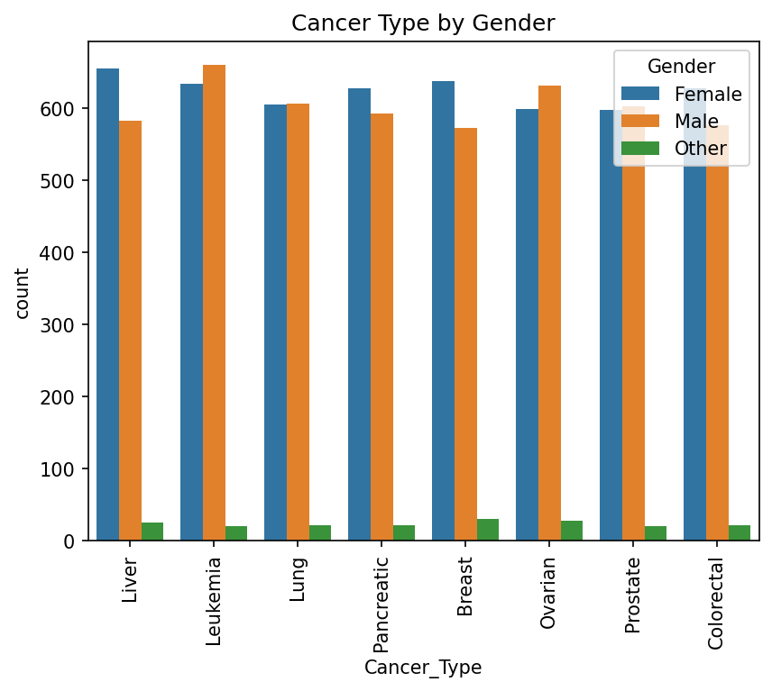
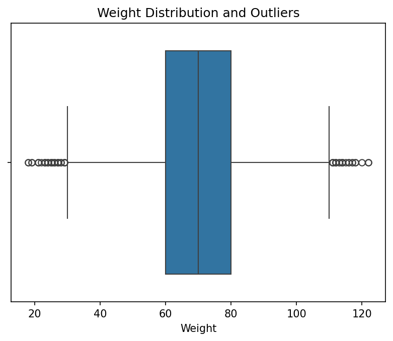
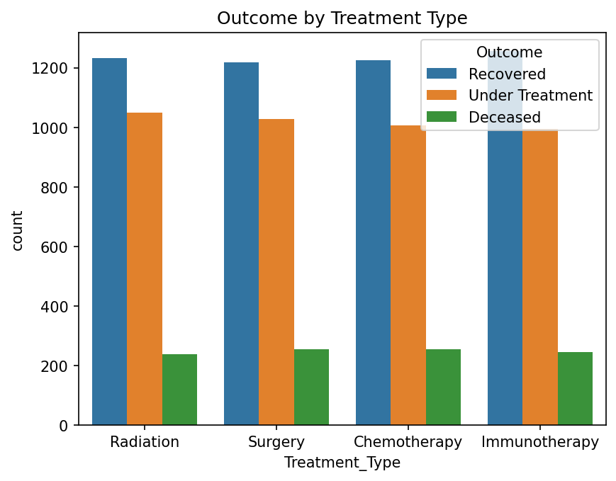
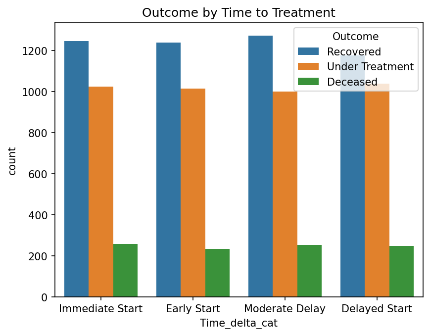

# 🩺 UAE Cancer Patient Exploratory Data Analysis (Python Project)

## 📌 Project Overview

This project uses Python to explore 10,000 cancer patient records from the United Arab Emirates. The dataset covers patient demographics, cancer type and stage, treatment, hospital, outcomes, smoking status, comorbidities, and body measurements for patients diagnosed between January 2015 and March 2024.

The analysis followed a standard EDA workflow: inspecting, cleaning, engineering features, and visualizing the data. It then went a step further. Using clinical knowledge, I ran plausibility checks and compared outcome rates across patient groups. These checks showed that the dataset is **synthetic**: it contains biologically impossible records, and patient outcomes do not change with cancer stage, treatment, smoking, or treatment delay. The project shows both the EDA methods and why checking whether medical data makes clinical sense is a critical first step.

## 🎯 Key Features

✅ Data Inspection: Reviewed 10,000 rows and 20 columns for data types, missing values, and duplicates. 
✅ Missing Value Review: Interpreted missing values clinically instead of treating them as errors. 
✅ Date Conversion: Converted diagnosis and treatment start dates to datetime format. 
✅ Feature Engineering: Created age groups and a time-to-treatment measure with four delay categories. 
✅ Outlier Detection: Used skewness and the IQR method to check age and weight. 
✅ Visualization: Built bar charts, distributions, a boxplot, and a scatter plot with Seaborn and Matplotlib. 
✅ Clinical Plausibility Checks: Tested the data for biologically impossible and unlikely records. 
✅ Outcome Rate Analysis: Compared death and recovery rates across stage, treatment, delay, and smoking status. 
✅ Bug Fix: Found and fixed a binning error that left 59 patients out of the analysis.

## 📷 Visualizations

### Cancer Type by Gender

### Weight Distribution and Outliers

### Outcome by Treatment Type

### Outcome by Time to Treatment

## 🗂️ Repository Files

| File | Description |
|------|-------------|
| `_cancer_dataset_uae.csv` | Raw dataset: 10,000 rows and 20 columns of patient records |
| `cancer_patient_eda.ipynb` | Jupyter Notebook with the full code, analysis, and outputs |
| `cancer_type_by_gender.png` | Cancer type counts split by gender |
| `weight_outliers.png` | Boxplot of patient weight and outliers |
| `outcome_by_treatment.png` | Patient outcomes for each treatment type |
| `outcome_by_time_to_treatment.png` | Patient outcomes by time to treatment |

## 🧹 Data Preparation

- Loaded the data with `pd.read_csv()` using a relative file path, so the notebook runs from any computer.
- Confirmed there are **no duplicate rows**.
- Reviewed missing values with clinical context:
  - **Death_Date and Cause_of_Death (9,008 missing):** left blank on purpose, because these patients did not die. Only 992 patients have a recorded death.
  - **Comorbidities (4,047 missing):** filled with "None," since a blank most likely means no comorbidity was recorded. This made it the largest group.
- Converted `Diagnosis_Date` and `Treatment_Start_Date` to datetime with `pd.to_datetime()`.
- Created `Age_cat` by splitting age into four groups at the 25th, 50th, and 75th percentiles.
- Created `Time_delta`, the number of days from diagnosis to treatment start, and grouped it into four categories: Immediate Start, Early Start, Moderate Delay, and Delayed Start.
- **Fixed a binning bug:** `pd.cut` leaves out the lowest value by default, so 59 patients who started treatment on the day of diagnosis had no category. Adding `include_lowest=True` brought them back into the analysis.

## 🛠️ Skills & Tools Applied

- Language and Environment: Python, Jupyter Notebook (Anaconda)
- Libraries: pandas, NumPy, Matplotlib, Seaborn
- pandas Techniques: `isna`, `duplicated`, `to_datetime`, `describe`, `cut`, `quantile`, `skew`, `crosstab`, `fillna`
- Statistics: Summary statistics, percentiles, skewness, IQR outlier detection, rate comparisons
- Clinical Data Review: Plausibility checks using medical knowledge
- Data Storytelling: Explaining data quality findings and their impact on conclusions

## 📈 Business Questions Answered

This project provides insights into:

- Who are the patients in this dataset, and what cancers do they have?
- How long do patients wait between diagnosis and treatment?
- Do outcomes differ by cancer stage, treatment type, treatment delay, or smoking status?
- Is the data clinically realistic enough to support real conclusions?

## 💡 Key Insights

### Patient Profile

- The dataset includes **10,000 patients**, aged 18 to 89 (average age 53.5), across 7 emirates and 4 hospitals.
- **59.2%** of patients were Emirati and the rest were expatriates.
- There were 8 cancer types. **Leukemia** was the most common (1,314 patients), and **Stage III** was the most common stage (3,041 patients).
- Outcomes: **49.3% recovered**, **40.8% were still under treatment**, and **9.9% died** (992 patients).
- The most common comorbidity was **hypertension** (2,945 patients), followed by diabetes (2,005) and cardiovascular disease (1,003). 4,047 patients had no comorbidity recorded.
- Patients waited a median of **90 days** from diagnosis to treatment, ranging from 0 to 179 days.

### Clinical Plausibility Checks

| Check | Records Found |
|---|---|
| Male patients with ovarian cancer | **632** |
| Female patients with prostate cancer | **598** |
| Adults weighing under 35 kg | **97** |
| Death recorded before diagnosis | 0 |
| Deceased patient with no death date | 0 |

- **1,230 records (about 12% of the dataset) are biologically impossible.** Men cannot have ovarian cancer, and women cannot have prostate cancer.
- **97 adults weigh under 35 kg** (about 77 lbs), with some as low as 18 kg. This is very unlikely for adult patients.
- The date checks passed, so the dataset follows logical date rules but not biological ones.

### Outcome Rates by Patient Group

| Grouping | Death Rate Range |
|---|---|
| Cancer stage (I to IV) | 8.8% to 11.0% |
| Treatment type | 9.4% to 10.2% |
| Time to treatment | 9.4% to 10.2% |
| Smoking status | 9.8% to 10.2% |

- **Stage IV patients died at almost the same rate as Stage I patients** (11.0% vs. 10.0%). In real cancer data, Stage IV mortality is many times higher.
- **Smoking had no effect on outcomes.** Smokers died at 10.0% and non-smokers at 9.8%, even though the dataset includes lung cancer.
- **Treatment delay had no effect.** Patients with a delayed start died at the same rate (10.1%) as those who started right away (10.2%).
- Mortality stayed at about **10% for every group**, which suggests outcomes were assigned at random rather than driven by clinical factors.

### Distribution Checks

- **Age was approximately symmetrical** (skewness of 0.0038) with no outliers. Ages were spread evenly from 18 to 89, while real cancer patients cluster at older ages.
- **Weight had outliers** at both ends: 18 to 29 kg and 111 to 122 kg.

*Note: Because of the impossible records and the flat outcome rates, this dataset appears to be synthetic. The findings demonstrate EDA methods and data quality checks, not real cancer patterns in the UAE. No conclusions about treatment effectiveness or patient risk should be drawn from it.*

## 🚀 Learning Outcomes

Building this project strengthened my skills in:

📌 Loading and exploring real-world healthcare datasets 
📌 Cleaning and preprocessing data 
📌 Performing Exploratory Data Analysis (EDA) with key pandas techniques 
📌 Finding patterns, trends, and correlations in medical data 
📌 Creating summary statistics and visualizations 
📌 Drawing insights from key health indicators 
📌 Visualizing patterns and trends in patient data 
📌 Interpreting results for better decision-making 
📌 Checking whether medical data is clinically plausible before trusting it

## 🔮 Next Steps

- Repeat the analysis on a real, de-identified cancer registry dataset, such as SEER, to compare findings.
- Build a reusable data quality checklist for clinical datasets, covering sex-specific diagnoses, plausible vital signs, and date logic.
- Add BMI from height and weight, and check it for clinically impossible values.
- Run survival analysis, such as Kaplan-Meier curves, using diagnosis and death dates.
- Use statistical tests, such as chi-square, to test whether outcome differences between groups are significant.

## 📚 Dataset Source

[UAE Cancer Patient Dataset](https://www.kaggle.com/datasets/ak0212/uae-cancer-patient-dataset) by ak0212 on Kaggle.

## 🙌 Acknowledgment

This was my first healthcare data project, and it taught me that clinical knowledge is part of the analysis, not separate from it. My background in patient care helped me notice that the data did not make medical sense, which changed how every chart and number should be read.

## 🔗 Related Link

[LinkedIn Post](https://www.linkedin.com/feed/update/urn:li:activity:7528186765443174400/)

## 👨‍💻 Author

**Omar Shazley**: Data Analyst | Python, Excel, SQL, and healthcare data analytics

💼 [LinkedIn](https://www.linkedin.com/in/omar-shazley-914a16b1/) 
💻 [GitHub Portfolio](https://github.com/Bromar95) 
📧 Email: [omarshazley@gmail.com](mailto:omarshazley@gmail.com)

✨ If you like this project, don't forget to ⭐ star the repo!
